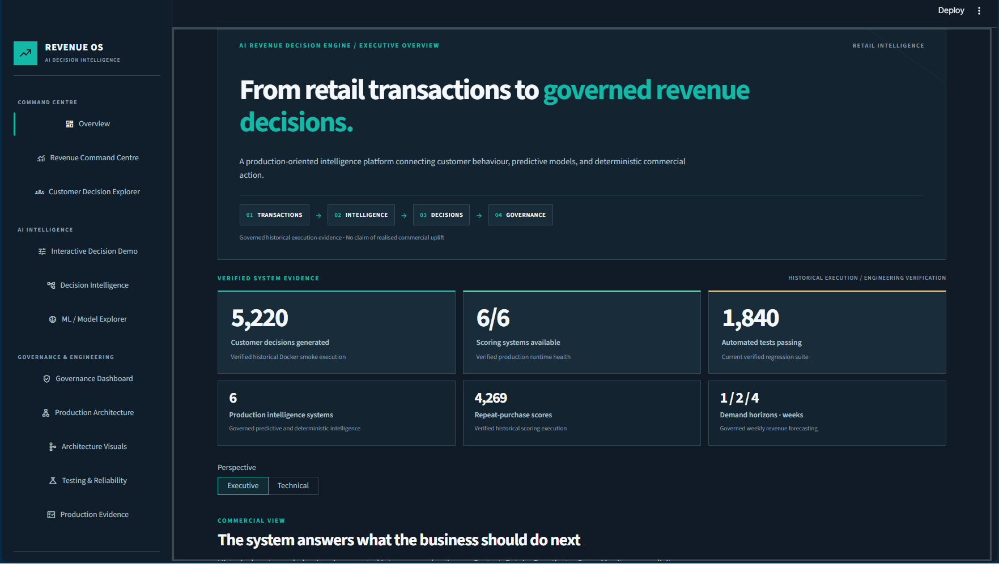
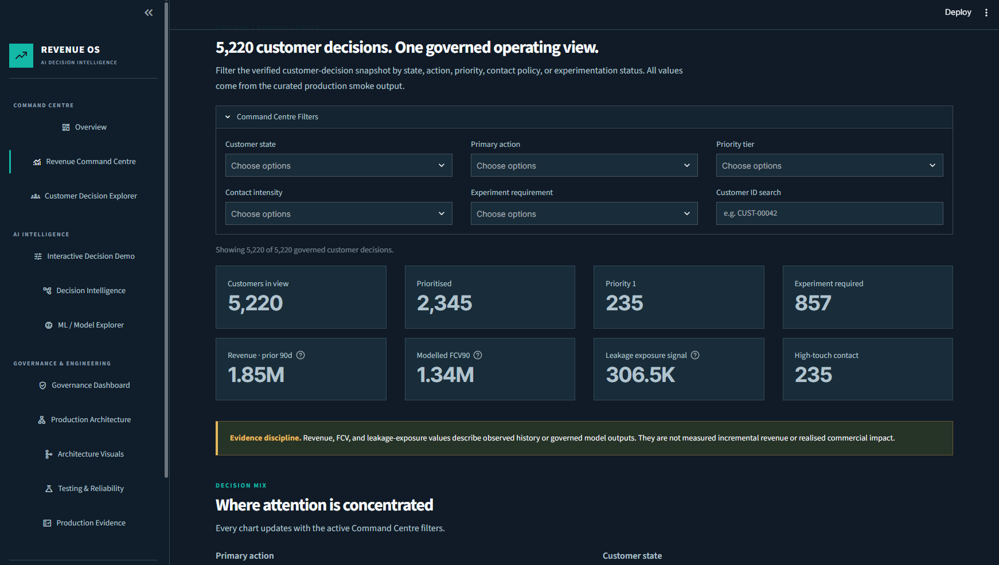
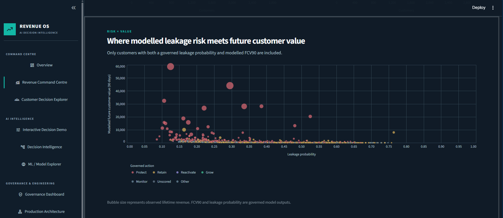
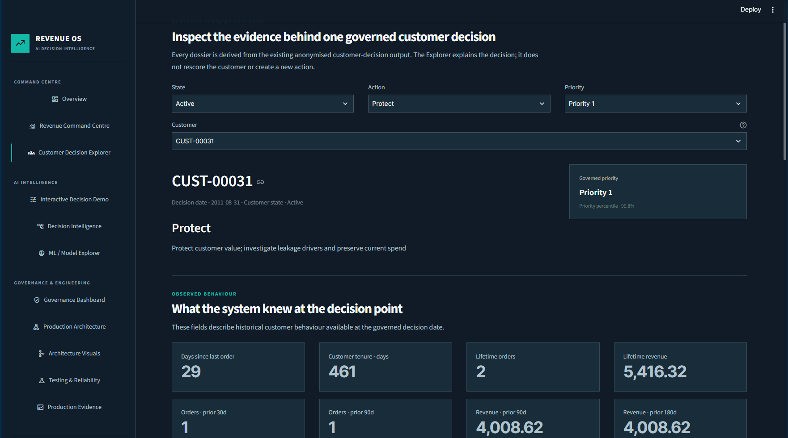
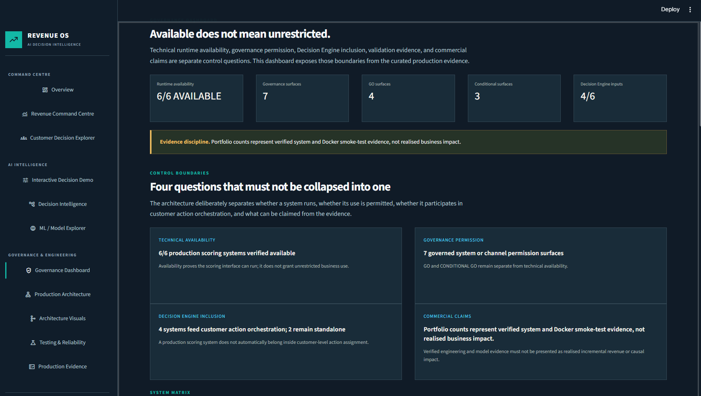
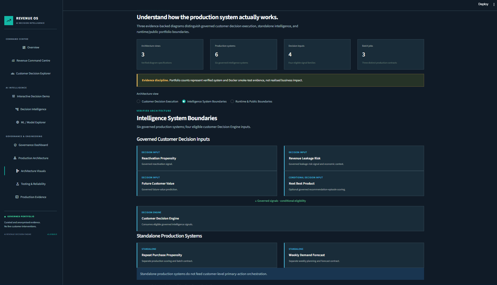

# AI Revenue Decision Engine

### From transactions to governed revenue decisions.

A production-oriented machine learning and decision intelligence system that transforms historical retail transactions into explainable customer actions, revenue-risk signals, recommendations, and demand forecasts.

The project connects predictive models to deterministic business policies, production scoring contracts, CRM delivery controls, experimentation, monitoring, automated tests, and Docker-based batch execution.

**This is more than a collection of machine learning notebooks. It demonstrates the engineering required to turn predictions into governed operational decisions.**

### Revenue OS — Executive Command Centre



*Premium executive interface showing the governed journey from retail transactions to decisions, with verified historical execution and engineering evidence.*

## At a Glance

| Verified project evidence | Result |
|---|---:|
| Production intelligence systems | 6 |
| Production scoring systems available | 6 / 6 |
| Customer decisions generated in Docker smoke execution | 5,220 |
| Repeat-purchase scores generated in Docker smoke execution | 4,269 |
| Governed demand forecast horizons | 1, 2 and 4 weeks |
| Automated regression tests passing | 1,915 |
| Test modules | 91 |
| Explicit test functions | 1,644 |
| Production batch jobs | 3 |
| Interactive architecture views | 3 |

These figures describe verified engineering capability and historical execution evidence, **not live customers served or realised revenue uplift**.

**Project status:** Production-oriented implementation with controlled deployment governance. The flagship portfolio `v1.0.0` release is in preparation. The system is not approved for unrestricted autonomous customer interventions.

---

## 1. The Business Problem

Retail businesses generate valuable transaction histories but often struggle to translate that information into coordinated commercial decisions.

Traditional reporting explains what happened. Individual predictive models estimate what might happen next. Neither automatically determines what a business should do.

The AI Revenue Decision Engine addresses five questions:

1. Which customers require attention?
2. What action should be considered?
3. How urgent is that action?
4. What contact or experimentation policy applies?
5. Is the underlying model evidence valid for this decision?

The result is a governed customer decision framework that helps connect customer intelligence to commercial operations.

## 2. The Solution

The system combines six production intelligence capabilities with a deterministic customer-level decision engine.

Four intelligence systems can contribute to customer decisions when their eligibility and governance conditions are satisfied. Two operate as separate forecasting or customer-lifecycle workflows.

### Production Intelligence Systems

| System | Business question | Governance | Operational role |
|---|---|---|---|
| Reactivation Propensity | Which inactive customers are likely to return? | GO | Decision Engine input |
| Revenue Leakage Risk | Which customers face potential future revenue decline? | GO | Decision Engine input |
| Future Customer Value | What positive merchandise revenue may a customer generate over the next 90 days? | CONDITIONAL GO | Decision Engine input |
| Next Best Product | Which product is relevant to the next eligible purchase? | GO for repeat; CONDITIONAL GO for discovery | Optional Decision Engine input |
| Repeat Purchase Propensity | Will a first-time customer purchase again within the governed horizon? | CONDITIONAL GO | Standalone scoring workflow |
| Weekly Demand Forecasting | What merchandise revenue is expected over the next 1, 2 and 4 weeks? | GO | Standalone forecasting workflow |

**Important:** Model availability does not imply unrestricted operational approval.

### Customer Decision Actions

The Decision Engine combines eligible signals, customer lifecycle state, business rules, and priority policies to assign one governed primary outcome.

| Action | Operational purpose |
|---|---|
| Protect | Prioritise commercially important relationships exposed to revenue decline |
| Retain | Address weakening customer engagement |
| Reactivate | Support controlled win-back activity for eligible dormant customers |
| Grow | Identify eligible product expansion opportunities |
| Monitor | Preserve visibility without requiring an immediate model-led intervention |
| Non-actionable / Unscored | Explicitly withhold unsupported model-led actions |

Action assignments are not independent model predictions. They result from governed decision logic.

### Priority and Contact Policy

Actionable decisions are ranked within their relevant action types.

Priority bands P1–P4 can map to contact-intensity categories such as High Touch, Campaign, Automated / Low Cost, and Hold / Control.

Non-actionable customers receive **No Model-Led Contact**.

Priority scores are operational ranking indices, not calibrated causal probabilities or guaranteed economic returns.

---

## 3. System Architecture

### Customer Decision Pipeline

```text
Historical Retail Transactions
            |
            v
   Canonical Data Contract
            |
            v
   Production Feature Builders
            |
            v
    Governed Model Scorers
            |
            v
  Score Registry / Snapshots
            |
            v
   Signal Eligibility & Alignment
            |
            v
 Deterministic Decision Engine
            |
            v
  Priority & Contact Policy
            |
            v
  Governed Customer Decisions
```

Four eligible intelligence channels contribute to the customer-level decision architecture:

- Reactivation Propensity
- Revenue Leakage Risk
- Future Customer Value
- Next Best Product, when a valid recommendation episode exists

Repeat Purchase and Weekly Demand Forecasting remain separate governed workflows.

### Operational Boundaries

The decision engine is deliberately separated from subsequent operations:

```text
Governed Decision Output
            |
            +--> Experiment Governance
            |
            +--> CRM Delivery Preparation
            |
            +--> Delivery Export / Audit
            |
            +--> Monitoring & Health Checks
```

These represent separate operational contracts, not an assertion that running the core decision batch automatically sends customer communications or executes experiments.

### Runtime Architecture

Three batch workloads are supported:

1. Month-end customer decisions
2. Repeat-purchase scoring
3. Weekly demand forecasting

A Python 3.11 Docker runtime provides the operational environment. The container runs as a non-root user.

The scheduled-job wrapper accepts an explicit job name and business boundary. **Scheduling itself belongs to an external scheduler**, which is not provisioned by this repository.

Production model binaries and operational state are kept separate from the curated public portfolio application.

---

## 4. Interactive Streamlit Portfolio

The Streamlit application provides an executive and technical exploration layer over portfolio-safe outputs.

### Explore the Revenue OS Platform

The interactive portfolio provides executive and technical views of the same governed production system.

#### Revenue Command Centre



*Explore the historical customer-decision snapshot through filters, commercial metrics, action priorities, and governance disclosures.*

#### Risk × Value Intelligence



*Examine governed leakage probabilities alongside modelled future customer value. Bubble size represents observed lifetime revenue; colour represents the governed action.*

#### Customer Decision Explorer



*Inspect anonymised customer-level decisions, supporting historical evidence, priority classification, and recommended actions.*

#### Governance Dashboard



*Distinguish technical availability, governance permission, customer-decision inclusion, and supported commercial claims.*

#### Production Architecture Visuals



*Explore the boundary between governed customer-decision inputs, the deterministic Decision Engine, and standalone production intelligence systems.*

**Evidence boundary:** These screenshots contain curated, anonymised historical outputs. They do not demonstrate realised commercial uplift or unrestricted autonomous interventions.


Launch locally:

```bash
python -m streamlit run app.py
```

The application supports exploration of:

- Customer decisions and commercial priorities
- Governed decision logic
- Model capabilities and limitations
- Revenue risk and customer value
- Repeat-purchase intelligence
- Weekly demand forecasting
- Model and decision governance
- Production architecture
- Architecture visualisations
- Testing and reliability evidence

The public presentation layer is designed to load compact, curated and anonymised datasets rather than running production scoring over the raw transaction dataset at startup.

Selected lightweight decision-policy functionality can be demonstrated interactively without creating a second, conflicting set of business rules.

**Live demo:** To be added following deployment verification.

---

## 5. Verified Engineering Evidence

### Automated Testing

The latest completed full regression reported:

```text
1850 passed, 1 warning
```

The following test-module and explicit-function inventory reflects an earlier audited snapshot; the latest total executed test count is 1,915.

The latest verified full regression comprises:

| Evidence | Verified result |
|---|---:|
| Automated regression tests passing | 1,915 |
| Portfolio-specific tests passing | 319 |
| Test failures | 0 |
| Nonfatal warnings | 1 |

The earlier test inventory recorded 91 modules, 1,644 explicit test functions, and 196 collection-expanded cases. Those historical breakdown figures have not yet been recalculated for the latest regression.

The known non-fatal warning occurs in the Repeat Purchase invalid-date handling test, where pandas reports a date-parsing format inference warning.

Testing covers contracts and behaviours across feature engineering, scoring, decision governance, portfolio data, operational workflows, and fail-closed conditions.

To execute the full local regression:

```bash
python -m pytest -q
```

The test runner requires `pytest` to be installed in the active development environment.

Portfolio-focused regression:

```bash
python -m pytest tests/test_portfolio_*.py -q
```

The latest verified portfolio suite passed **319 tests**.

### Docker Smoke-Test Evidence

The governed Docker execution produced:

| Workload | Verified result |
|---|---|
| Customer decisions | 5,220 output rows |
| Repeat-purchase scoring | 4,269 output rows |
| Demand forecasting | 1-, 2- and 4-week forecasts |
| Runtime | Linux, non-root execution verified |
| Delivery controls | Duplicate delivery reruns rejected |
| Audit | Persistent delivery audit verified |
| Scheduling validation | Invalid demand business boundary rejected |

These are operational verification results from historical data, not claims of live commercial service or achieved uplift.

---

## 6. Research and Model Validation

The repository preserves the original research workflow alongside production implementations.

### Research Notebooks

| Notebook | Purpose |
|---|---|
| `01_Data_Cleaning.ipynb` | Canonical transaction preparation |
| `02_ML_Repeat_Purchase_Model.ipynb` | Early-lifecycle repeat-purchase modelling |
| `03_ML_Reactivation_Propensity.ipynb` | Reactivation propensity |
| `04_ML_Revenue_Leakage_Risk.ipynb` | Revenue leakage risk |
| `05_ML_Future_Customer_Value.ipynb` | Future customer revenue prioritisation |
| `06_ML_Next_Best_Product.ipynb` | Repeat and discovery recommendations |
| `07_ML_Demand_Forecasting.ipynb` | Weekly demand forecasting |
| `08_Customer_Decision_Engine.ipynb` | Customer-level decision orchestration |

### Selected Governed Research Metrics

These are historical evaluation metrics, not realised business impact.

| Model | Metric | Verified value |
|---|---|---:|
| Future Customer Value | Stage A PR-AUC | 0.822148 |
| Future Customer Value | Complete-model Spearman | 0.550464 |
| Future Customer Value | Revenue Capture@20% | 0.686870 |
| Repeat Recommendation | Holdout Hit Rate@20 | 0.792319 |
| Discovery Recommendation | Holdout Hit Rate@20 | 0.299238 |
| Repeat Purchase | Test ROC-AUC | 0.560 |
| Repeat Purchase | Test PR-AUC | 0.503 |
| Demand Forecast | Approximate 1-week historical WAPE | 0.1652 |
| Demand Forecast | Approximate 4-week historical WAPE | 0.1684 |

The Repeat Purchase and discovery recommendation results are intentionally presented with their conditional governance context.

Reactivation and Revenue Leakage models do not receive invented headline performance metrics where their governed production manifests do not expose equivalent locked final values.

### Historical Research Population

The original research README records **5,224 identified customers** in the August 2011 historical decision snapshot.

The separately verified Docker smoke execution generated **5,220 customer decision rows**.

These figures originate from different documented evidence contexts and should not be presented as interchangeable population counts.

---

## 7. Governance and Safety Controls

### Temporal Integrity

Time-dependent scoring must respect the information available at the decision boundary.

Key controls include:

- Features must not use future outcomes.
- Training and evaluation eligibility must be separated from production eligibility.
- Model predictions must remain valid for the customer's current lifecycle state.
- Later customer events can invalidate earlier scores.
- Recommendation episodes cannot be reconstructed from future-conditioned research evaluation data.
- Demand forecasts must respect complete observed weekly periods.

### Fail-Closed Design

Unsupported or invalid operations are rejected rather than silently interpreted as valid inputs.

Examples include:

- Missing required features
- Schema drift
- Invalid forecast origin dates
- Unsupported forecast horizons
- Duplicate delivery identifiers
- Malformed audit records
- Invalid model or score eligibility

### Experimentation

A propensity prediction does not prove that a customer intervention caused an outcome.

Incremental commercial impact requires an appropriate treatment-control experiment.

Discovery recommendations remain subject to CONDITIONAL GO governance and controlled testing.

### Revenue and Risk Interpretation

Revenue leakage exposure is a prioritisation proxy, **not calibrated expected accounting loss**.

Future Customer Value describes expected positive merchandise revenue over a governed horizon, not lifetime value, contribution margin or guaranteed revenue.

The system does not currently provide live inventory availability gating for product recommendations.

### Autonomous Intervention

The project is designed for governed decision support, controlled CRM prioritisation, and experimentation.

It is not approved for unrestricted autonomous customer intervention.

---

## 8. Local Setup

### Requirements

- Python 3.11 is the Docker runtime baseline.
- A Python environment with the packages in `requirements.txt`.
- Additional development tooling such as `pytest` for test execution.
- Curated portfolio data for the Streamlit application.
- Separately provisioned governed model binaries and canonical transaction data for production scoring workflows.

Clone the repository:

```bash
git clone https://github.com/vaatiian/ai-revenue-decision-engine.git
cd ai-revenue-decision-engine
```

Create and activate a Python environment:

```bash
python -m venv .venv
```

On Windows:

```bash
.venv\Scripts\activate
```

On Linux or macOS:

```bash
source .venv/bin/activate
```

Install application dependencies:

```bash
python -m pip install -r requirements.txt
```

For development tests:

```bash
python -m pip install pytest
```

Launch the portfolio:

```bash
python -m streamlit run app.py
```

### Important Data Boundary

The public portfolio application and the production scoring runtime have different dependencies.

Cloning the repository and installing Python packages does not automatically provision private data, trained model binaries, or persistent operational state.

Production commands require their relevant governed inputs and manifests.

---

## 9. Production Command-Line Interface

The operational entry point is:

```bash
python -m src.cli
```

Inspect available operations:

```bash
python -m src.cli --help
```

### Runtime Health

```bash
python -m src.cli health
```

By default, the health command verifies governed model source hashes. A diagnostic option is available to disable that particular check, but should not be treated as equivalent to the fully verified health path.

### Month-End Customer Decision Batch

```bash
python -m src.cli customer-batch \
  --data /path/to/canonical_transactions.parquet \
  --decision-date 2011-08-31 \
  --output-dir /path/to/outputs
```

Optional parameters include:

```text
--recommendation-episodes PATH
--delivery-audit PATH
```

A recommendation episode must meet its production governance contract. The delivery audit is a separate persistent operational concern.

### Repeat Purchase Batch

```bash
python -m src.cli repeat-purchase \
  --data /path/to/canonical_transactions.parquet \
  --modeling-end-date 2011-08-31 \
  --output-dir /path/to/outputs
```

An optional `--include-opening-month` flag changes the historical-parity opening-month exclusion policy.

### Weekly Demand Forecast

```bash
python -m src.cli demand \
  --data /path/to/canonical_transactions.parquet \
  --forecast-origin-week 2011-11-21 \
  --output-dir /path/to/outputs \
  --horizons 1 2 4
```

The forecast origin must be a valid Monday week-start representing the final complete observed week.

Only the governed horizons of **1, 2 and 4 weeks** are supported.

All dates above illustrate the documented historical boundary format. Successful execution also depends on valid data, model artifacts, source verification, and writable output locations.

---

## 10. Docker and Scheduled Operations

Build the production runtime image:

```bash
docker build -t ai-revenue-decision-engine .
```

The Dockerfile uses `python:3.11-slim` and runs the application as a non-root user.

Its default operation is:

```bash
python -m src.cli health
```

The image is intentionally a one-shot operational runtime, not an always-running web server.

### External Scheduler Contract

The scheduled-job wrapper supports:

```text
run_scheduled_job.sh customer YYYY-MM-DD
run_scheduled_job.sh repeat-purchase YYYY-MM-DD
run_scheduled_job.sh demand YYYY-MM-DD
```

It reads runtime paths from environment variables including:

```text
DATA_PATH
OUTPUT_DIR
DELIVERY_AUDIT_PATH
RECOMMENDATION_EPISODES_PATH
PYTHON_BIN
```

The wrapper does not:

- calculate its own execution dates;
- decide month-end or Monday scheduling boundaries;
- retrain models;
- launch multiple workflows automatically;
- provision an external scheduler.

Runtime deployments must provide the required input data, model artifacts, persistent storage, permissions, and scheduling infrastructure.

---

## 11. Portfolio Data and Privacy

The public Streamlit application is separated from production source data and runtime state.

Curated portfolio datasets are generated from governed outputs with deterministic anonymisation and a restricted field contract.

Public data classifications include:

- PUBLIC
- PUBLIC_AFTER_ANONYMISATION
- TECHNICAL_SUMMARY_ONLY
- EXCLUDED

The public application excludes raw transaction datasets, operational audit histories, sensitive research evaluation rows, and production model binaries.

See:

- [Portfolio Data Contract](portfolio/PORTFOLIO_DATA_CONTRACT.md)
- [Portfolio Narrative](portfolio/PORTFOLIO_NARRATIVE.md)

The deterministic portfolio-data generator is:

```bash
python portfolio/generate_portfolio_data.py
```

This generator requires its documented governed source artifacts. It is not necessary to regenerate those artifacts simply to explore an already prepared public portfolio.

---

## 12. Repository Structure

```text
ai-revenue-decision-engine/
├── app.py                     # Streamlit portfolio application
├── portfolio/                 # Portfolio presentation and curated data
│   ├── data/
│   ├── architecture_visuals.py
│   ├── architecture_visuals_page.py
│   ├── testing_reliability.py
│   ├── generate_portfolio_data.py
│   ├── PORTFOLIO_NARRATIVE.md
│   └── PORTFOLIO_DATA_CONTRACT.md
├── src/
│   ├── data/                  # Production data contracts
│   ├── features/              # Production feature builders
│   ├── models/                # Model and forecast contracts
│   ├── scoring/               # Governed scoring
│   ├── decision_engine/       # Decision orchestration
│   ├── deployment/            # Production batch workloads
│   ├── monitoring/            # Operational health
│   └── cli.py                 # Operational CLI
├── tests/                     # Automated validation
├── notebooks/                 # Research and evaluation
├── artifacts/                 # Governed model metadata and artifacts
├── config/                    # Configuration
├── scripts/
│   └── run_scheduled_job.sh
├── docs/                      # Technical documentation
├── Dockerfile
├── requirements.txt
└── README.md
```

The public portfolio is an inspection and demonstration interface. The production engine remains the source of operational decision and scoring behaviour.

---

## 13. Project Status and Roadmap

### Implemented and Verified

- Research pipeline and governed model specifications
- Six production scoring systems
- Customer decision orchestration
- Priority and contact policies
- CRM delivery and audit controls
- Experiment governance
- Runtime health monitoring
- Three production batch interfaces
- Docker smoke execution
- Curated public portfolio data
- Interactive Streamlit exploration
- Architecture visualisations
- Testing and reliability evidence

### Remaining Portfolio Release Work

- Final GitHub documentation and screenshot publication verification
- Demo media
- Portfolio application testing
- End-to-end quality assurance
- Public deployment
- Final `v1.0.0` release and repository cleanup

A verified Docker smoke test is not equivalent to a completed public cloud deployment.

---

## 14. Responsible Interpretation

This repository demonstrates the full engineering path from transaction data through machine learning to governed operational recommendations.

Its results must be interpreted according to their evidence category:

| Evidence category | Meaning |
|---|---|
| Model evaluation | Historical research or test-set performance |
| Production smoke execution | Evidence that governed code ran against a specified historical workload |
| Operational capability | A supported engineering interface or control |
| Portfolio demonstration | A curated representation of verified system behaviour |
| Realised business impact | Measured outcomes attributable to real-world interventions |

**No realised revenue uplift, retention uplift, or conversion uplift is claimed without measured experimental evidence.**

---

## 15. Project Principle

> Predictions are not decisions. Decisions are not interventions. Interventions are not impact.

The AI Revenue Decision Engine is designed to make these boundaries explicit, testable, auditable, and operationally useful.

**From transactions to governed revenue decisions.**
